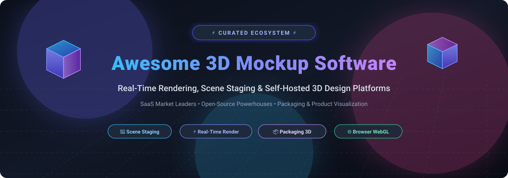
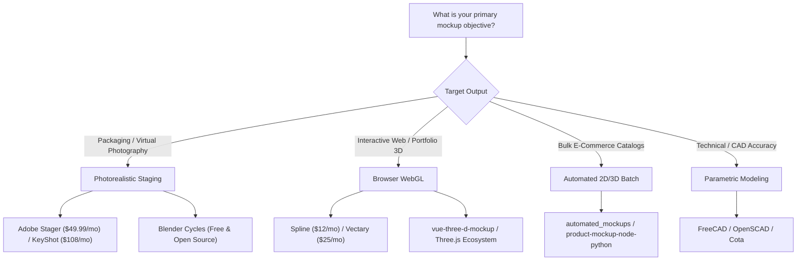

# Awesome 3D Mockup & Design Software 

  

  
  
  
  
  
  

---

## 🚀 Overview & Ecosystem

A curated list of **3D mockup design software, scene staging environments, photorealistic rendering suites, and self-hosted CAD platforms**. Whether you need to render ultra-realistic product packaging, assemble interactive 3D WebGL scenes for e-commerce, or automate brand asset mockups with scripts, this directory covers market-leading commercial platforms and community-driven open-source alternatives.

### 🔍 Key Capabilities Covered
- 🎨 **Scene Staging & Presentation**: Virtual photo studios for lighting, camera composition, and photorealistic product presentation.
- ⚡ **Real-Time Rendering**: Interactive ray tracing, path tracing, and GPU rasterization for instant previews.
- 📦 **Packaging & Branding Mockups**: 3D carton, bottle, pouch, and apparel visualizations directly from dielines.
- 🌐 **Browser-Based WebGL & Collaboration**: Cloud-native 3D canvases allowing cross-functional team feedback and real-time canvas embedding.
- 🛠️ **Open-Source & Self-Hosted Pipelines**: Fully controllable modeling, texturing, and rendering workflows without vendor lock-in.

---

## 📑 Table of Contents

- [📊 Sector Overview & Market Dynamics](#-sector-overview--market-dynamics)
- [🏢 SaaS & Hosted Commercial Platforms](#-saas--hosted-commercial-platforms)
- [💻 Open-Source GitHub Projects](#-open-source-github-projects)
- [💡 Choosing the Right 3D Toolchain](#-choosing-the-right-3d-toolchain)
- [🤝 How to Contribute](#-how-to-contribute)
- [⭐ Star History](#-star-history)
- [💖 Support & Sponsorship](#-support--sponsorship)
- [⚖️ Disclaimer](#️-disclaimer)

---

## 📊 Sector Overview & Market Dynamics

The global 3D modeling, rendering, and staging software market is valued at approximately **$25–$30 billion**, experiencing robust ~15–20% CAGR driven by e-commerce visualization, spatial computing, and real-time WebGL workflows.

The sector is **moderately fragmented**: enterprise incumbents (Adobe, Autodesk, Trimble, Dassault Systèmes) dominate high-end engineering and creative pipelines, while specialized browser-native tools (such as Spline, Vectary, and Womp) and dominant open-source platforms (Blender, FreeCAD) capture massive creator adoption, preventing a winner-take-all outcome.

---

## 🏢 SaaS & Hosted Commercial Platforms

*Commercial 3D mockup tools, virtual photography platforms, and scene assemblers sorted descending by company size / market valuation.*

| Product | Company Size / Valuation | Pricing (Starting Tier) | Free Tier / Trial Limit | Description |
| :--- | :--- | :--- | :--- | :--- |
| **[Adobe Substance 3D Stager](https://www.adobe.com/products/substance3d/apps/stager.html)** | Enterprise Leader (~$95B–$100B Market Cap) | **$49.99/month** (Substance 3D Collection monthly) or **$599.88/year** ($49.99/mo billed annually) | **30-day full-featured free trial**; no permanent free tier. Full access to Stager, Painter, Designer, Sampler, 25 monthly 3D asset downloads, and 100GB cloud storage during trial. | Industry benchmark virtual photography studio to stage 3D models, configure physical lighting, and render photorealistic product visualizations. |
| **[SketchUp](https://www.sketchup.com/)** | Enterprise Public (~$14B Market Cap - Trimble Inc.) | **$129/year** (~$19.99/month on SketchUp Go) | **SketchUp Free web tier** (restricted to non-commercial personal use, browser-only, 10GB cloud storage, limited file exports, no extensions, no desktop app) plus **7-day free trial** of Pro. | Widely adopted intuitive 3D modeling software for architectural, packaging dielines, and interior product mockups. |
| **[Cinema 4D](https://www.maxon.net/)** | Mid-Large Enterprise (~$9.5B Parent Market Cap - Nemetschek Group) | **$69.91/month** (billed annually at ~$839/year) or **$109/month** month-to-month | **14-day fully-unrestricted free trial** via Maxon App (includes Maxon One suite + Redshift GPU renderer; no credit card required); no permanent free tier. | Premium 3D modeling, simulation, and high-end motion graphics staging software equipped with Redshift rendering engine. |
| **[KeyShot](https://www.keyshot.com/)** | Mid-Market B2B (~$150M–$160M Valuation / ~$25M ARR - Luxion/GRO Capital) | **$108.25/month** (billed annually at $1,299/year for Professional) | **14-day free trial** (watermarked outputs, active license for evaluation); no permanent free tier. | Dedicated real-time ray-tracing and staging software tailored specifically for product visualizers, CMF designers, and packaging engineers. |
| **[Spline](https://spline.design/)** | High-Growth Scaleup (~$50M–$100M Valuation / $32M Funding) | **$12/month** (billed annually at $144/year) or **$15/month** month-to-month | **Permanent Free tier** (unlimited personal files, unlimited public viewers, access to basic Spline 3D library, web exports include Spline watermark). | Modern collaborative browser-based 3D design and interaction tool featuring physics, web interactions, and code exports. |
| **[Vectary](https://www.vectary.com/)** | Venture-Backed Startup (~$29M–$37M Valuation / $14M Funding) | **$25/month** (billed annually on Starter) or **$35/month** month-to-month | **Permanent Free tier** (up to 5 active projects, 1 workspace seat, Studio & Canvas access, basic 3D import/export, interactive share links with Vectary watermark). | Cloud-native 3D modeling and Augmented Reality (AR) staging platform designed for rapid web configurators and product previews. |
| **[Womp 3D](https://www.womp.com/)** | Early-Stage Startup (~$24M Valuation / $8M Funding) | **$9.99/month** (billed annually) or **$14.99/month** monthly (Pro Tier) | **Permanent Free tier** (300 daily AI generation credits, standard material library, full HD render/video export, community models; 4K exports and Super Materials restricted). | Intuitive real-time browser 3D modeler using signed distance fields (liquid/clay booleans), ideal for stylized product branding and mockups. |
| **[Marmoset Toolbag](https://marmoset.co/)** | Bootstrapped Studio (~$5M–$15M Estimated Annual Revenue) | **$18.99/month** (Individual subscription) or **$399.00 one-time** perpetual license | **30-day fully functional free trial** (unrestricted access to baking, rendering, and asset library per major release); no permanent free tier. | Real-time GPU rendering, baking, and material preview suite widely celebrated by 3D asset designers and product visualizers. |

---

## 💻 Open-Source GitHub Projects

*Open-source 3D suites, parametric CAD modelers, and mockup generation frameworks sorted descending by GitHub star count.*

- **[Blender](https://github.com/blender/blender)**  🌟  
  **The definitive open-source 3D creation and rendering suite.** Covers complete modeling, sculpting, procedural materials, rigging, and photorealistic rendering via **Cycles** (path-tracer) and **EEVEE** (real-time GPU engine). Unrivaled tutorial ecosystem, active community add-ons for packaging and lighting stages, completely free without licensing fees or DRM.  
  *Tech stack: C, C++, Python • License: GPL-3.0*

- **[FreeCAD](https://github.com/FreeCAD/FreeCAD)**  📐  
  **Parametric open-source 3D CAD modeler.** Tailor-made for precise mechanical dimensions, technical packaging structures, enclosures, and sheet metal dielines. Integrates seamlessly with Blender for downstream lighting and texturing.  
  *Tech stack: C++, Python, Qt • License: LGPL-2.1*

- **[OpenSCAD](https://github.com/openscad/openscad)**  💻  
  **The programmers' solid 3D CAD modeler.** Creates 3D mockups and CAD objects through script-based constructive solid geometry (CSG). Exceptional for automated generation of parametric containers, boxes, and dimensional prototypes from code.  
  *Tech stack: C++ • License: GPL-2.0*

- **[LibreCAD](https://github.com/LibreCAD/LibreCAD)**  📏  
  **Open-source 2D Computer-Aided Design application.** Crucial for drafting precise packaging dielines, folding blueprints, carton layouts, and technical drawings before extruding into 3D environments.  
  *Tech stack: C++, Qt • License: GPL-2.0*

- **[ArmorPaint](https://github.com/armory3d/armorpaint)**  🖌️  
  **Node-based 3D PBR texture painting software.** A stand-alone tool designed to paint physically based materials directly onto 3D objects and packaging assets, acting as a viable open-source alternative to Substance Painter.  
  *Tech stack: Haxe, C, Krom • License: Zlib*

- **[automated_mockups](https://github.com/CTDave001/automated_mockups)**  👕  
  **Scriptable automated apparel & merchandise mockup pipeline.** Python utility utilizing computer vision techniques to composite artwork, logos, and typography realistically onto apparel templates.  
  *Tech stack: Python • License: MIT*

- **[mockupgen](https://github.com/rmenon1008/mockupgen)**  📱  
  **Fast device mockup generator CLI.** Generates high-fidelity device mockups (smartphones, laptops, tablets) from UI screenshots using automated homography transformations with OpenCV.  
  *Tech stack: Python, OpenCV • License: MIT*

- **[vue-three-d-mockup](https://github.com/anatolykopyl/vue-three-d-mockup)**  📱  
  **Interactive 3D device mockup component for web applications.** Built on Vue.js and Three.js, enabling developers to showcase mobile screenshots and app interactions on rotating 3D devices directly in the browser.  
  *Tech stack: Vue.js, Three.js, JavaScript • License: MIT*

- **[product-mockup-node-python](https://github.com/kashifulhaque/product-mockup-node-python)**  ☕  
  **Automated batch product mockup generator.** Employs ImageMagick, Node.js, and Python to project 2D brand artwork onto mugs, bottles, and boxes for automated e-commerce catalog pipelines.  
  *Tech stack: Node.js, Python, ImageMagick • License: MIT*

- **[Cota](https://github.com/mxchristian17/cota)**  📐  
  **Browser-native command-line 2D/3D CAD tool.** Features real 3D solids, boolean operations, dimensioned viewports, and vector PDF exports with zero installation or account requirements.  
  *Tech stack: TypeScript, WebAssembly, Canvas • License: Apache-2.0*

---

## 💡 Choosing the Right 3D Toolchain

---

## 🤝 How to Contribute

Contributions are welcome! Help us keep this directory accurate, up-to-date, and comprehensive:

1. 🍴 **Fork the repository** on GitHub.
2. 🌿 **Create a new branch**: `git checkout -b feature/add-new-software`.
3. ✏️ **Add your software**: Follow the existing table/list formatting with:
   - Name and website / repository link
   - Specific starting pricing tier and exact free tier / trial limitations
   - Company valuation, revenue, or GitHub star badge
   - Concise 1–2 sentence description of target use case
4. 🧪 **Check link validity**: Ensure all URLs are active.
5. 🚀 **Submit a Pull Request** with a descriptive explanation of the proposed changes.

---

## ⭐ Star History

---

## 💖 Support & Sponsorship

If this curated 3D design and mockup ecosystem guide helped you save hours of research, streamline your rendering pipeline, or discover the perfect design software, please consider supporting the project!

- ⭐ **Star this repository** to help others discover it on GitHub.
- 🍴 **Fork and share** with your network, design team, or engineering peers.
- ☕ **Sponsor & Buy a Coffee**: Support continuous updates, research, and maintenance through the [GitHub Sponsor Dashboard](https://github.com/sponsors/ishandutta2007).

---

## ⚖️ Disclaimer

- This repository is a **community-curated index** intended for informational and educational purposes. Inclusion does not imply endorsement.
- All product names, trademarks, logos, and brands belong to their respective owners.
- Pricing, subscription tiers, and free trial terms are subject to change by software vendors; always verify official pricing pages before purchasing.
- Note that **Clara.io** ceased service on December 31, 2022 (pivoting into Threekit e-commerce), and is preserved in historical references.

---

  <b>Crafted with ❤️ for 3D artists, packaging designers, and creative technologists.</b>

